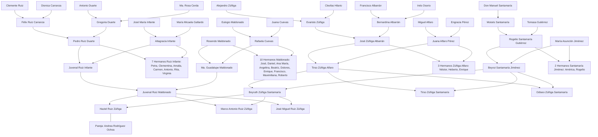

# Árbol Genealógico Familiar en Prolog

**Instituto Tecnológico de Morelia (TecNM)**  
**Departamento de Sistemas y Computación — Ingeniería en Sistemas Computacionales**

| Campo                                   | Detalle                                                                                               |
|:----------------------------------------|:------------------------------------------------------------------------------------------------------|
| **Asignatura**                          | Programación Lógica y Funcional                                                                       |
| **Docente**                             | Prof. Jesús Eduardo Alcaraz Chávez                                                                    |
| **Alumno**                              | Haziel Ruiz Zúñiga                                                                                    |
| **Lenguaje / Motor**                    | Prolog (Estándar ISO / SWI-Prolog)                                                                    |
| **Alcance de la Base de Conocimientos** | 6 generaciones · 4 ramas familiares · 110 personas · 140 hechos `progenitor/2` · 34 hechos `pareja/2` |

## 1. Descripción del Proyecto

Este repositorio implementa una **Base de Conocimientos Genealógica en Prolog** que modela el árbol familiar real de la familia **Ruiz Zúñiga** a lo largo de seis generaciones, integrando las cuatro ramas principales de ascendencia paterna y materna:

1. **Rama Paterna-Paterna (Ruiz – Duarte – Infante – Carranza):** Desde los trastatarabuelos Clemente Ruiz y Dionica Carranza, Antonio Duarte y Ma. Rosa Cerda, y José María Infante y María Micaela Gallardo, pasando por Félix Ruiz Carranza, Pedro Ruiz Duarte y Altagracia Infante, hasta el abuelo paterno Juvenal Ruiz Infante y sus hermanos.
2. **Rama Paterna-Materna (Maldonado – Cuevas):** Desde Eulogio Maldonado y Juana Cuevas, pasando por los bisabuelos Rosendo Maldonado y Rafaela Cuevas, hasta la abuela paterna Ma. Guadalupe Maldonado y sus diez hermanos.
3. **Rama Materna-Paterna (Zúñiga – Albarrán – Alfaro – Pérez):** Desde Alejandro Zúñiga y Cleofas Hilario, y Francisco Albarrán e Inés Osorio, pasando por Evaristo Zúñiga y Bernardina Albarrán, y José Zúñiga Albarrán y Juana Alfaro Pérez, hasta el abuelo materno Tirso Zúñiga Alfaro y sus hermanos.
4. **Rama Materna-Materna (Santamaría – Gutiérrez – Jiménez):** Desde el primer antepasado registrado en la línea, Don Manuel Santamaría, pasando por Moisés Santamaría y Tomasa Gutiérrez, y los bisabuelos Rogelio Santamaría Gutiérrez y María Asunción Jiménez, hasta la abuela materna Beyrut Santamaría Jiménez, la madre Beyruth Zúñiga Santamaría y los tíos maternos.

## 2. Diagrama General de Ascendencia Directa y Colateral

El siguiente diagrama en formato **Mermaid** (compatible nativamente con GitHub Markdown) ilustra la conexión entre las cuatro ramas genealógicas principales que convergen en la generación central:



## 3. Arquitectura de Hechos y Reglas en Prolog

### 3.1. Convención de Nombres y Predicados Base (Hechos)

Para cumplir con la sintaxis estándar de átomos en Prolog (minúsculas y `snake_case`, sin espacios ni tildes que requieran comillas simples), cada persona se representa mediante un identificador único descriptivo (por ejemplo, `haziel_ruiz_zuniga`). La base de hechos se apoya únicamente en cuatro predicados extensionales:

| Predicado Base     | Aridad | Significado Lógico                                     | Ejemplo en el Código                                         |
|:-------------------|:------:|:-------------------------------------------------------|:-------------------------------------------------------------|
| `hombre(Persona)`  |   1    | Declara que `Persona` es de sexo masculino.            | `hombre(haziel_ruiz_zuniga).`                                |
| `mujer(Persona)`   |   1    | Declara que `Persona` es de sexo femenino.             | `mujer(beyruth_zuniga_santamaria).`                          |
| `progenitor(P, H)` |   2    | Declara que `P` es padre o madre biológico de `H`.     | `progenitor(juvenal_ruiz_maldonado, haziel_ruiz_zuniga).`    |
| `pareja(X, Y)`     |   2    | Declara la unión conyugal o de pareja entre `X` e `Y`. | `pareja(juvenal_ruiz_maldonado, beyruth_zuniga_santamaria).` |

### 3.2. Reglas de Inferencia Implementadas

A partir de los hechos base, el motor de inferencia deduce todas las relaciones familiares solicitadas (padres, abuelos, hermanos y tíos) y relaciones extendidas:

| Categoría      | Regla en Prolog                         | Definición Formal (Cláusula de Horn)                                              | Descripción                                                           |
|:---------------|:----------------------------------------|:----------------------------------------------------------------------------------|:----------------------------------------------------------------------|
| **Padres**     | `padre(P, H)`                           | `progenitor(P, H), hombre(P).`                                                    | `P` es el padre de `H`.                                               |
| **Padres**     | `madre(M, H)`                           | `progenitor(M, H), mujer(M).`                                                     | `M` es la madre de `H`.                                               |
| **Padres**     | `padres(P, M, H)`                       | `padre(P, H), madre(M, H).`                                                       | Obtiene simultáneamente al padre `P` y madre `M` de `H`.              |
| **Hijos**      | `hijo(H, P)` / `hija(H, P)`             | `progenitor(P, H), hombre(H).` / `mujer(H).`                                      | `H` es hijo varón o hija mujer de `P`.                                |
| **Abuelos**    | `abuelo(A, N)`                          | `progenitor(A, P), progenitor(P, N), hombre(A).`                                  | `A` es abuelo paterno o materno de `N`.                               |
| **Abuelos**    | `abuela(A, N)`                          | `progenitor(A, P), progenitor(P, N), mujer(A).`                                   | `A` es abuela paterna o materna de `N`.                               |
| **Abuelos**    | `abuelos(A, N)`                         | `progenitor(A, P), progenitor(P, N).`                                             | `A` es abuelo o abuela de `N` (sin distinción de sexo).               |
| **Hermanos**   | `hermanos(X, Y)`                        | `padre(P, X), padre(P, Y), X \= Y.`                                               | `X` e `Y` son hermanos (evita respuestas duplicadas por padre/madre). |
| **Hermanos**   | `hermano(X, Y)`                         | `hermanos(X, Y), hombre(X).`                                                      | `X` es hermano varón de `Y`.                                          |
| **Hermanos**   | `hermana(X, Y)`                         | `hermanos(X, Y), mujer(X).`                                                       | `X` es hermana mujer de `Y`.                                          |
| **Tíos**       | `tio_consanguineo(T, S)`                | `progenitor(P, S), hermanos(T, P).`                                               | `T` es hermano/a de alguno de los padres de `S`.                      |
| **Tíos**       | `tio_politico(T, S)`                    | `progenitor(P, S), hermanos(H, P), casados(T, H).`                                | `T` es cónyuge de un hermano/a de los padres de `S`.                  |
| **Tíos**       | `tio(T, S)` / `tia(T, S)`               | `(tio_consanguineo(T, S) ; tio_politico(T, S)), hombre(T) / mujer(T).`            | `T` es tío o tía (consanguíneo o político) de `S`.                    |
| **Extendidas** | `tio_abuelo(T, S)` / `tia_abuela(T, S)` | `abuelos(A, S), hermanos(T, A), hombre(T) / mujer(T).`                            | `T` es hermano o hermana de alguno de los abuelos de `S`.             |
| **Extendidas** | `bisabuelo(B, N)` / `tatarabuelo(T, N)` | Encadenamiento de 3 y 4 niveles de `progenitor/2`.                                | Ascendencia de 3ª y 4ª generación.                                    |
| **Recursiva**  | `ancestro(A, D)`                        | Caso base `progenitor(A, D)` + paso recursivo `progenitor(A, X), ancestro(X, D).` | Recorre cualquier número de generaciones hacia arriba.                |

## 4. Resumen de Integrantes por Rama Genealógica

### 4.1. Núcleo Familiar Directo (Generaciones 0, 1 y 2)

| Parentesco con Haziel | Nombre Completo en el Árbol           | Átomo en Prolog             |
|:----------------------|:--------------------------------------|:----------------------------|
| **Persona Central**   | Haziel Ruiz Zúñiga (2003–Vivo)        | `haziel_ruiz_zuniga`        |
| **Pareja**            | Andrea Rodríguez Ochoa (2003–Viva)    | `andrea_rodriguez_ochoa`    |
| **Hermano**           | Marco Antonio Ruiz Zúñiga (2004–Vivo) | `marco_antonio_ruiz_zuniga` |
| **Hermano**           | José Miguel Ruiz Zúñiga (2009–Vivo)   | `jose_miguel_ruiz_zuniga`   |
| **Padre**             | Juvenal Ruiz Maldonado (1968–Vivo)    | `juvenal_ruiz_maldonado`    |
| **Madre**             | Beyruth Zúñiga Santamaría (1976–Viva) | `beyruth_zuniga_santamaria` |
| **Tío Materno**       | Tirso Zúñiga Santamaría (1974–Vivo)   | `tirso_zuniga_santamaria`   |
| **Tío Materno**       | Odiseo Zúñiga Santamaría (1975–Vivo)  | `odiseo_zuniga_santamaria`  |
| **Abuelo Paterno**    | Juvenal Ruiz Infante                  | `juvenal_ruiz_infante`      |
| **Abuela Paterna**    | Ma. Guadalupe Maldonado               | `ma_guadalupe_maldonado`    |
| **Abuelo Materno**    | Tirso Zúñiga Alfaro (1948–2019)       | `tirso_zuniga_alfaro`       |
| **Abuela Materna**    | Beyrut Santamaría Jiménez (Viva)      | `beyrut_santamaria_jimenez` |

### 4.2. Ascendencia Extendida (Generaciones 3, 4 y 5)

| Rama Familiar                           | Bisabuelos (Gen. 3)                                                           | Tatarabuelos (Gen. 4)                                                              | Trastatarabuelos (Gen. 5)                                            |
|:----------------------------------------|:------------------------------------------------------------------------------|:-----------------------------------------------------------------------------------|:---------------------------------------------------------------------|
| **1. Ruiz – Duarte – Infante**          | Pedro Ruiz Duarte y Altagracia Infante                                        | Félix Ruiz Carranza y Gregoria Duarte; José María Infante y María Micaela Gallardo | Clemente Ruiz y Dionica Carranza; Antonio Duarte y Ma. Rosa Cerda    |
| **2. Maldonado – Cuevas**               | Rosendo Maldonado y Rafaela Cuevas                                            | Eulogio Maldonado y Juana Cuevas                                                   | —                                                                    |
| **3. Zúñiga – Albarrán – Alfaro**       | José Zúñiga Albarrán y Juana Alfaro Pérez                                     | Evaristo Zúñiga y Bernardina Albarrán; Miguel Alfaro y Engracia Pérez              | Alejandro Zúñiga y Cleofas Hilario; Francisco Albarrán e Inés Osorio |
| **4. Santamaría – Gutiérrez – Jiménez** | Rogelio Santamaría Gutiérrez (1934–1998) y María Asunción Jiménez (1936–1983) | Moisés Santamaría (1884–1965) y Tomasa Gutiérrez (1915–1999)                       | Don Manuel Santamaría (Padre de 10 hijos nacidos entre 1871 y 1894+) |

## 5. Código Fuente Completo (`arbol_familiar.pl`)

Guarda el siguiente bloque en un archivo llamado `arbol_familiar.pl`:

```prolog
% ==============================================================================
% ÁRBOL GENEALÓGICO FAMILIAR EN PROLOG
% Materia: Programación Lógica y Funcional
% Docente: Prof. Jesús Eduardo Alcaraz Chávez
% Alumno:  Haziel Ruiz Zúñiga
% Carrera: Ingeniería en Sistemas Computacionales (ITM)
% ==============================================================================

:- discontiguous hombre/1.
:- discontiguous mujer/1.
:- discontiguous progenitor/2.
:- discontiguous pareja/2.

% ==============================================================================
% 1. BASE DE CONOCIMIENTOS (HECHOS)
% ==============================================================================

% ------------------------------------------------------------------------------
% GENERACIÓN CENTRAL (Haziel, hermanos y pareja)
% ------------------------------------------------------------------------------
hombre(haziel_ruiz_zuniga).
hombre(marco_antonio_ruiz_zuniga).
hombre(jose_miguel_ruiz_zuniga).
mujer(andrea_rodriguez_ochoa).

pareja(haziel_ruiz_zuniga, andrea_rodriguez_ochoa).

% ------------------------------------------------------------------------------
% PADRES DE HAZIEL (1ª Generación Ascendente)
% ------------------------------------------------------------------------------
hombre(juvenal_ruiz_maldonado).
mujer(beyruth_zuniga_santamaria).

pareja(juvenal_ruiz_maldonado, beyruth_zuniga_santamaria).

progenitor(juvenal_ruiz_maldonado, haziel_ruiz_zuniga).
progenitor(beyruth_zuniga_santamaria, haziel_ruiz_zuniga).

progenitor(juvenal_ruiz_maldonado, marco_antonio_ruiz_zuniga).
progenitor(beyruth_zuniga_santamaria, marco_antonio_ruiz_zuniga).

progenitor(juvenal_ruiz_maldonado, jose_miguel_ruiz_zuniga).
progenitor(beyruth_zuniga_santamaria, jose_miguel_ruiz_zuniga).

% ------------------------------------------------------------------------------
% RAMA 1: LÍNEA PATERNA-PATERNA (RUIZ - DUARTE - INFANTE - CARRANZA)
% ------------------------------------------------------------------------------

% --- Abuelos Paternos y Tíos Abuelos (Hijos de Pedro Ruiz Duarte y Altagracia Infante) ---
hombre(juvenal_ruiz_infante).
mujer(ma_guadalupe_maldonado).
pareja(juvenal_ruiz_infante, ma_guadalupe_maldonado).

progenitor(juvenal_ruiz_infante, juvenal_ruiz_maldonado).
progenitor(ma_guadalupe_maldonado, juvenal_ruiz_maldonado).

mujer(petra_ruiz_infante).
mujer(clementina_ruiz_infante).
hombre(graciano_magana).
mujer(amalia_ruiz_infante).
hombre(severiano_camarillo).
mujer(carmen_ruiz_infante).
hombre(antonio_ruiz_infante).
mujer(rita_ruiz_infante).
hombre(guadalupe_mora).
mujer(virginia_ruiz_infante).
hombre(santos_mora).

pareja(graciano_magana, clementina_ruiz_infante).
pareja(severiano_camarillo, amalia_ruiz_infante).
pareja(guadalupe_mora, rita_ruiz_infante).
pareja(santos_mora, virginia_ruiz_infante).

% --- Bisabuelos Paternos (Rama Ruiz-Infante) ---
hombre(pedro_ruiz_duarte).
mujer(altagracia_infante).
pareja(pedro_ruiz_duarte, altagracia_infante).

progenitor(pedro_ruiz_duarte, petra_ruiz_infante).
progenitor(altagracia_infante, petra_ruiz_infante).
progenitor(pedro_ruiz_duarte, clementina_ruiz_infante).
progenitor(altagracia_infante, clementina_ruiz_infante).
progenitor(pedro_ruiz_duarte, amalia_ruiz_infante).
progenitor(altagracia_infante, amalia_ruiz_infante).
progenitor(pedro_ruiz_duarte, carmen_ruiz_infante).
progenitor(altagracia_infante, carmen_ruiz_infante).
progenitor(pedro_ruiz_duarte, antonio_ruiz_infante).
progenitor(altagracia_infante, antonio_ruiz_infante).
progenitor(pedro_ruiz_duarte, rita_ruiz_infante).
progenitor(altagracia_infante, rita_ruiz_infante).
progenitor(pedro_ruiz_duarte, virginia_ruiz_infante).
progenitor(altagracia_infante, virginia_ruiz_infante).
progenitor(pedro_ruiz_duarte, juvenal_ruiz_infante).
progenitor(altagracia_infante, juvenal_ruiz_infante).

% Hermanos de Pedro Ruiz Duarte (Hijos de Félix Ruiz Carranza y Gregoria Duarte)
mujer(maria_p_ruiz).
hombre(gonzalo_ruiz).
hombre(crispin_ruiz_duarte).
mujer(dolores_barajas).
hombre(luis_ruiz).
mujer(maria_maldonado_ruiz).

pareja(crispin_ruiz_duarte, dolores_barajas).
pareja(luis_ruiz, maria_maldonado_ruiz).

% --- Tatarabuelos Paternos (Félix Ruiz Carranza y Gregoria Duarte / José María Infante y María Micaela Gallardo) ---
hombre(felix_ruiz_carranza).
mujer(gregoria_duarte).
pareja(felix_ruiz_carranza, gregoria_duarte).

progenitor(felix_ruiz_carranza, maria_p_ruiz).
progenitor(gregoria_duarte, maria_p_ruiz).
progenitor(felix_ruiz_carranza, gonzalo_ruiz).
progenitor(gregoria_duarte, gonzalo_ruiz).
progenitor(felix_ruiz_carranza, crispin_ruiz_duarte).
progenitor(gregoria_duarte, crispin_ruiz_duarte).
progenitor(felix_ruiz_carranza, luis_ruiz).
progenitor(gregoria_duarte, luis_ruiz).
progenitor(felix_ruiz_carranza, pedro_ruiz_duarte).
progenitor(gregoria_duarte, pedro_ruiz_duarte).

hombre(jose_maria_infante).
mujer(maria_micaela_gallardo).
pareja(jose_maria_infante, maria_micaela_gallardo).

progenitor(jose_maria_infante, altagracia_infante).
progenitor(maria_micaela_gallardo, altagracia_infante).

% Hermanos de Félix Ruiz Carranza (Hijos de Clemente Ruiz y Dionica Carranza)
mujer(maria_cl_ruiz).
hombre(juan_bautista_ruiz_carranza).
mujer(maria_t_ruiz).
hombre(leonardo_villagomez_1).
mujer(victoria_zamores).
hombre(santiago_tavares).
hombre(victor_ruiz_carranza).
mujer(juana_guillen).
mujer(una_infanta_ruiz_carranza).
mujer(luisa_ruiz).
mujer(tomaza_ruiz_carranza).
hombre(jesus_duarte).
mujer(maria_l_ruiz_carranza).
hombre(leonardo_villagomez_2).

pareja(leonardo_villagomez_1, maria_t_ruiz).
pareja(santiago_tavares, victoria_zamores).
pareja(victor_ruiz_carranza, juana_guillen).
pareja(jesus_duarte, tomaza_ruiz_carranza).
pareja(leonardo_villagomez_2, maria_l_ruiz_carranza).

% --- Trastatarabuelos Paternos (Clemente Ruiz y Dionica Carranza / Antonio Duarte y Ma. Rosa Cerda) ---
hombre(clemente_ruiz).
mujer(dionica_carranza).
pareja(clemente_ruiz, dionica_carranza).

progenitor(clemente_ruiz, maria_cl_ruiz).
progenitor(dionica_carranza, maria_cl_ruiz).
progenitor(clemente_ruiz, juan_bautista_ruiz_carranza).
progenitor(dionica_carranza, juan_bautista_ruiz_carranza).
progenitor(clemente_ruiz, maria_t_ruiz).
progenitor(dionica_carranza, maria_t_ruiz).
progenitor(clemente_ruiz, victoria_zamores).
progenitor(dionica_carranza, victoria_zamores).
progenitor(clemente_ruiz, victor_ruiz_carranza).
progenitor(dionica_carranza, victor_ruiz_carranza).
progenitor(clemente_ruiz, una_infanta_ruiz_carranza).
progenitor(dionica_carranza, una_infanta_ruiz_carranza).
progenitor(clemente_ruiz, luisa_ruiz).
progenitor(dionica_carranza, luisa_ruiz).
progenitor(clemente_ruiz, tomaza_ruiz_carranza).
progenitor(dionica_carranza, tomaza_ruiz_carranza).
progenitor(clemente_ruiz, maria_l_ruiz_carranza).
progenitor(dionica_carranza, maria_l_ruiz_carranza).
progenitor(clemente_ruiz, felix_ruiz_carranza).
progenitor(dionica_carranza, felix_ruiz_carranza).

hombre(antonio_duarte).
mujer(ma_rosa_cerda).
pareja(antonio_duarte, ma_rosa_cerda).

progenitor(antonio_duarte, gregoria_duarte).
progenitor(ma_rosa_cerda, gregoria_duarte).

% ------------------------------------------------------------------------------
% RAMA 2: LÍNEA PATERNA-MATERNA (MALDONADO - CUEVAS)
% ------------------------------------------------------------------------------

% --- Bisabuelos y Tatarabuelos (Rama Maldonado-Cuevas) ---
hombre(eulogio_maldonado).
mujer(juana_cuevas).
pareja(eulogio_maldonado, juana_cuevas).

hombre(rosendo_maldonado).
mujer(rafaela_cuevas).
pareja(rosendo_maldonado, rafaela_cuevas).

progenitor(eulogio_maldonado, rafaela_cuevas).
progenitor(juana_cuevas, rafaela_cuevas).

% Hijos de Rosendo Maldonado y Rafaela Cuevas (Abuela paterna Ma. Guadalupe y sus hermanos)
hombre(jose_maldonado).
hombre(daniel_maldonado).
mujer(ana_maria_maldonado).
mujer(angelina_maldonado).
mujer(beatriz_maldonado).
mujer(dolores_maldonado).
hombre(enrique_maldonado).
hombre(francisco_maldonado).
mujer(maximiliana_maldonado).
hombre(roberto_maldonado).

progenitor(rosendo_maldonado, ma_guadalupe_maldonado).
progenitor(rafaela_cuevas, ma_guadalupe_maldonado).
progenitor(rosendo_maldonado, jose_maldonado).
progenitor(rafaela_cuevas, jose_maldonado).
progenitor(rosendo_maldonado, daniel_maldonado).
progenitor(rafaela_cuevas, daniel_maldonado).
progenitor(rosendo_maldonado, ana_maria_maldonado).
progenitor(rafaela_cuevas, ana_maria_maldonado).
progenitor(rosendo_maldonado, angelina_maldonado).
progenitor(rafaela_cuevas, angelina_maldonado).
progenitor(rosendo_maldonado, beatriz_maldonado).
progenitor(rafaela_cuevas, beatriz_maldonado).
progenitor(rosendo_maldonado, dolores_maldonado).
progenitor(rafaela_cuevas, dolores_maldonado).
progenitor(rosendo_maldonado, enrique_maldonado).
progenitor(rafaela_cuevas, enrique_maldonado).
progenitor(rosendo_maldonado, francisco_maldonado).
progenitor(rafaela_cuevas, francisco_maldonado).
progenitor(rosendo_maldonado, maximiliana_maldonado).
progenitor(rafaela_cuevas, maximiliana_maldonado).
progenitor(rosendo_maldonado, roberto_maldonado).
progenitor(rafaela_cuevas, roberto_maldonado).

% ------------------------------------------------------------------------------
% RAMA 3: LÍNEA MATERNA-PATERNA (ZÚÑIGA - ALBARRÁN - ALFARO - PÉREZ)
% ------------------------------------------------------------------------------

% --- Abuelos Maternos y Tíos Maternos (Hijos de Tirso Zúñiga Alfaro y Beyrut Santamaría) ---
hombre(tirso_zuniga_alfaro).
mujer(beyrut_santamaria_jimenez).
pareja(tirso_zuniga_alfaro, beyrut_santamaria_jimenez).

hombre(tirso_zuniga_santamaria).
hombre(odiseo_zuniga_santamaria).

progenitor(tirso_zuniga_alfaro, tirso_zuniga_santamaria).
progenitor(beyrut_santamaria_jimenez, tirso_zuniga_santamaria).
progenitor(tirso_zuniga_alfaro, odiseo_zuniga_santamaria).
progenitor(beyrut_santamaria_jimenez, odiseo_zuniga_santamaria).
progenitor(tirso_zuniga_alfaro, beyruth_zuniga_santamaria).
progenitor(beyrut_santamaria_jimenez, beyruth_zuniga_santamaria).

% --- Bisabuelos Maternos (José Zúñiga Albarrán y Juana Alfaro Pérez) ---
hombre(jose_zuniga_albarran).
mujer(juana_alfaro_perez).
pareja(jose_zuniga_albarran, juana_alfaro_perez).

hombre(nestor_zuniga_alfaro).
hombre(heberto_zuniga_alfaro).
hombre(enrique_zuniga_alfaro).

progenitor(jose_zuniga_albarran, nestor_zuniga_alfaro).
progenitor(juana_alfaro_perez, nestor_zuniga_alfaro).
progenitor(jose_zuniga_albarran, heberto_zuniga_alfaro).
progenitor(juana_alfaro_perez, heberto_zuniga_alfaro).
progenitor(jose_zuniga_albarran, enrique_zuniga_alfaro).
progenitor(juana_alfaro_perez, enrique_zuniga_alfaro).
progenitor(jose_zuniga_albarran, tirso_zuniga_alfaro).
progenitor(juana_alfaro_perez, tirso_zuniga_alfaro).

% --- Tatarabuelos Maternos (Evaristo Zúñiga y Bernardina Albarrán / Miguel Alfaro y Engracia Pérez) ---
hombre(evaristo_zuniga).
mujer(bernardina_albarran).
pareja(evaristo_zuniga, bernardina_albarran).

hombre(daniel_zuniga_albarran).
mujer(maria_zuniga_albarran).
mujer(maria_lacion_zuniga_albarran).
mujer(consuelo_zuniga_albarran).
mujer(francisca_zuniga_albarran).
hombre(isauro_hernandez).
pareja(isauro_hernandez, francisca_zuniga_albarran).

progenitor(evaristo_zuniga, daniel_zuniga_albarran).
progenitor(bernardina_albarran, daniel_zuniga_albarran).
progenitor(evaristo_zuniga, maria_zuniga_albarran).
progenitor(bernardina_albarran, maria_zuniga_albarran).
progenitor(evaristo_zuniga, maria_lacion_zuniga_albarran).
progenitor(bernardina_albarran, maria_lacion_zuniga_albarran).
progenitor(evaristo_zuniga, consuelo_zuniga_albarran).
progenitor(bernardina_albarran, consuelo_zuniga_albarran).
progenitor(evaristo_zuniga, francisca_zuniga_albarran).
progenitor(bernardina_albarran, francisca_zuniga_albarran).
progenitor(evaristo_zuniga, jose_zuniga_albarran).
progenitor(bernardina_albarran, jose_zuniga_albarran).

hombre(miguel_alfaro).
mujer(engracia_perez).
pareja(miguel_alfaro, engracia_perez).

progenitor(miguel_alfaro, juana_alfaro_perez).
progenitor(engracia_perez, juana_alfaro_perez).

% --- Trastatarabuelos Maternos (Alejandro Zúñiga y Cleofas Hilario / Francisco Albarrán e Inés Osorio) ---
hombre(alejandro_zuniga).
mujer(cleofas_hilario).
pareja(alejandro_zuniga, cleofas_hilario).

progenitor(alejandro_zuniga, evaristo_zuniga).
progenitor(cleofas_hilario, evaristo_zuniga).

hombre(francisco_albarran).
mujer(ines_osorio).
pareja(francisco_albarran, ines_osorio).

progenitor(francisco_albarran, bernardina_albarran).
progenitor(ines_osorio, bernardina_albarran).

% ------------------------------------------------------------------------------
% RAMA 4: LÍNEA MATERNA-MATERNA (SANTAMARÍA - GUTIÉRREZ - JIMÉNEZ)
% ------------------------------------------------------------------------------

% --- Bisabuelos Maternos (Rogelio Santamaría Gutiérrez y María Asunción Jiménez) ---
hombre(rogelio_santamaria_gutierrez).
mujer(maria_asuncion_jimenez).
pareja(rogelio_santamaria_gutierrez, maria_asuncion_jimenez).

mujer(america_santamaria_jimenez).
hombre(jaime_iglesias).
hombre(rogelio_santamaria_jimenez).
pareja(jaime_iglesias, america_santamaria_jimenez).

progenitor(rogelio_santamaria_gutierrez, america_santamaria_jimenez).
progenitor(maria_asuncion_jimenez, america_santamaria_jimenez).
progenitor(rogelio_santamaria_gutierrez, beyrut_santamaria_jimenez).
progenitor(maria_asuncion_jimenez, beyrut_santamaria_jimenez).
progenitor(rogelio_santamaria_gutierrez, rogelio_santamaria_jimenez).
progenitor(maria_asuncion_jimenez, rogelio_santamaria_jimenez).

% --- Tatarabuelos Maternos (Moisés Santamaría y Tomasa Gutiérrez) ---
hombre(moises_santamaria).
mujer(tomasa_gutierrez).
pareja(moises_santamaria, tomasa_gutierrez).

hombre(homero_santamaria_gutierrez).
mujer(maria_de_lourdes_santamaria_gutierrez).
hombre(porfirio_santamaria_gutierrez).
mujer(maria_clotilde_santamaria_gutierrez).
hombre(federico_moctezuma).
pareja(federico_moctezuma, maria_clotilde_santamaria_gutierrez).

progenitor(moises_santamaria, rogelio_santamaria_gutierrez).
progenitor(tomasa_gutierrez, rogelio_santamaria_gutierrez).
progenitor(moises_santamaria, homero_santamaria_gutierrez).
progenitor(tomasa_gutierrez, homero_santamaria_gutierrez).
progenitor(moises_santamaria, maria_de_lourdes_santamaria_gutierrez).
progenitor(tomasa_gutierrez, maria_de_lourdes_santamaria_gutierrez).
progenitor(moises_santamaria, porfirio_santamaria_gutierrez).
progenitor(tomasa_gutierrez, porfirio_santamaria_gutierrez).
progenitor(moises_santamaria, maria_clotilde_santamaria_gutierrez).
progenitor(tomasa_gutierrez, maria_clotilde_santamaria_gutierrez).

% --- Trastatarabuelo Materno (Don Manuel Santamaría y sus hijos) ---
hombre(manuel_santamaria).

hombre(jose_juan_santamaria).
mujer(maria_clotilde_santamaria_1).
hombre(alejandro_santamaria).
mujer(ana_maria_cervantes).
hombre(porfirio_santamaria_1).
hombre(francisco_santamaria).
hombre(vicente_santamaria).
mujer(maria_jesus_rodriguez).
mujer(alquilina_santamaria).
mujer(clotilde_santamaria).
mujer(maria_de_la_luz_santamaria).

pareja(alejandro_santamaria, ana_maria_cervantes).
pareja(vicente_santamaria, maria_jesus_rodriguez).

progenitor(manuel_santamaria, jose_juan_santamaria).
progenitor(manuel_santamaria, maria_clotilde_santamaria_1).
progenitor(manuel_santamaria, alejandro_santamaria).
progenitor(manuel_santamaria, porfirio_santamaria_1).
progenitor(manuel_santamaria, moises_santamaria).
progenitor(manuel_santamaria, francisco_santamaria).
progenitor(manuel_santamaria, vicente_santamaria).
progenitor(manuel_santamaria, alquilina_santamaria).
progenitor(manuel_santamaria, clotilde_santamaria).
progenitor(manuel_santamaria, maria_de_la_luz_santamaria).


% ==============================================================================
% 2. REGLAS DE INFERENCIA LÓGICA
% ==============================================================================

% ------------------------------------------------------------------------------
% 2.1 Reglas de Matrimonio / Pareja (Simetría)
% ------------------------------------------------------------------------------
casados(X, Y) :- pareja(X, Y).
casados(X, Y) :- pareja(Y, X).

% ------------------------------------------------------------------------------
% 2.2 Reglas de Padres e Hijos
% ------------------------------------------------------------------------------
% X es padre de Y si X es progenitor de Y y X es hombre.
padre(P, H) :-
    progenitor(P, H),
    hombre(P).

% X es madre de Y si X es progenitor de Y y X es mujer.
madre(M, H) :-
    progenitor(M, H),
    mujer(M).

% P y M son los padres de H.
padres(P, M, H) :-
    padre(P, H),
    madre(M, H).

% H es hijo/hija de P.
hijo(H, P) :-
    progenitor(P, H),
    hombre(H).

hija(H, P) :-
    progenitor(P, H),
    mujer(H).

% ------------------------------------------------------------------------------
% 2.3 Reglas de Abuelos, Bisabuelos y Ancestros
% ------------------------------------------------------------------------------
% A es abuelo (masculino) de N.
abuelo(A, N) :-
    progenitor(A, P),
    progenitor(P, N),
    hombre(A).

% A es abuela (femenina) de N.
abuela(A, N) :-
    progenitor(A, P),
    progenitor(P, N),
    mujer(A).

% A es abuelo o abuela de N (sin distinción de género).
abuelos(A, N) :-
    progenitor(A, P),
    progenitor(P, N).

% N es nieto o nieta de A.
nieto(N, A) :-
    abuelos(A, N),
    hombre(N).

nieta(N, A) :-
    abuelos(A, N),
    mujer(N).

% Bisabuelos (3ª generación ascendente)
bisabuelo(B, N) :-
    progenitor(B, A),
    abuelos(A, N),
    hombre(B).

bisabuela(B, N) :-
    progenitor(B, A),
    abuelos(A, N),
    mujer(B).

% Tatarabuelos (4ª generación ascendente)
tatarabuelo(T, N) :-
    progenitor(T, B),
    progenitor(B, A),
    abuelos(A, N),
    hombre(T).

tatarabuela(T, N) :-
    progenitor(T, B),
    progenitor(B, A),
    abuelos(A, N),
    mujer(T).

% Regla recursiva de Ancestro / Descendiente
ancestro(A, D) :-
    progenitor(A, D).
ancestro(A, D) :-
    progenitor(A, X),
    ancestro(X, D).

descendiente(D, A) :-
    ancestro(A, D).

% ------------------------------------------------------------------------------
% 2.4 Reglas de Hermanos
% ------------------------------------------------------------------------------
% X y Y son hermanos si comparten al menos un progenitor y son personas distintas.
% Se usa once/1 en la comprobación o distinción por padre/madre para evitar duplicados.
hermanos(X, Y) :-
    padre(P, X),
    padre(P, Y),
    X \= Y.

% Caso alternativo cuando solo se registra madre en común (sin padre registrado):
hermanos(X, Y) :-
    madre(M, X),
    madre(M, Y),
    \+ (padre(P, X), padre(P, Y)),
    X \= Y.

% X es hermano (hombre) de Y.
hermano(X, Y) :-
    hermanos(X, Y),
    hombre(X).

% X es hermana (mujer) de Y.
hermana(X, Y) :-
    hermanos(X, Y),
    mujer(X).

% ------------------------------------------------------------------------------
% 2.5 Reglas de Tíos, Sobrinos y Primos
% ------------------------------------------------------------------------------
% Tío/tía consanguíneo (hermano o hermana del padre o de la madre)
tio_consanguineo(T, S) :-
    progenitor(P, S),
    hermanos(T, P).

% Tío/tía político (pareja del hermano o hermana del padre o de la madre)
tio_politico(T, S) :-
    progenitor(P, S),
    hermanos(H, P),
    casados(T, H).

% T es tío (hombre) de S (incluye consanguíneos y políticos).
tio(T, S) :-
    (tio_consanguineo(T, S) ; tio_politico(T, S)),
    hombre(T).

% T es tía (mujer) de S (incluye consanguíneas y políticas).
tia(T, S) :-
    (tio_consanguineo(T, S) ; tio_politico(T, S)),
    mujer(T).

% T es tío o tía de S (general).
tios(T, S) :-
    tio_consanguineo(T, S) ; tio_politico(T, S).

% Tíos abuelos (hermanos de los abuelos)
tio_abuelo(T, S) :-
    abuelos(A, S),
    hermanos(T, A),
    hombre(T).

tia_abuela(T, S) :-
    abuelos(A, S),
    hermanos(T, A),
    mujer(T).

% S es sobrino/sobrina de T.
sobrino(S, T) :-
    tios(T, S),
    hombre(S).

sobrina(S, T) :-
    tios(T, S),
    mujer(S).

% X y Y son primos si sus respectivos progenitores son hermanos.
primos(X, Y) :-
    progenitor(P1, X),
    progenitor(P2, Y),
    hermanos(P1, P2).

primo(X, Y) :-
    primos(X, Y),
    hombre(X).

prima(X, Y) :-
    primos(X, Y),
    mujer(X).
```

## 6. Guía de Uso y Consultas de Prueba en SWI-Prolog

### 6.1. Cómo cargar la Base de Conocimientos

Desde la terminal, inicia SWI-Prolog cargando el archivo:

```bash
swipl -s arbol_familiar.pl
```

O bien, dentro de la consola interactiva de Prolog:

```prolog
?- [arbol_familiar].
true.
```

### 6.2. Batería de Consultas (`Queries`) y Resultados Esperados

| Objetivo de la Consulta                                                                               | Comando en SWI-Prolog (`?-`)                          | Resultado Esperado del Motor Lógico                                                                                                                                                                                                                                                                                      |
|:------------------------------------------------------------------------------------------------------|:------------------------------------------------------|:-------------------------------------------------------------------------------------------------------------------------------------------------------------------------------------------------------------------------------------------------------------------------------------------------------------------------|
| **1. Consultar el padre de Haziel**                                                                   | `?- padre(Padre, haziel_ruiz_zuniga).`                | `Padre = juvenal_ruiz_maldonado.`                                                                                                                                                                                                                                                                                        |
| **2. Consultar la madre de Haziel**                                                                   | `?- madre(Madre, haziel_ruiz_zuniga).`                | `Madre = beyruth_zuniga_santamaria.`                                                                                                                                                                                                                                                                                     |
| **3. Consultar ambos padres a la vez**                                                                | `?- padres(Padre, Madre, haziel_ruiz_zuniga).`        | `Padre = juvenal_ruiz_maldonado, Madre = beyruth_zuniga_santamaria.`                                                                                                                                                                                                                                                     |
| **4. Listar los hermanos de Haziel**                                                                  | `?- hermano(Hermano, haziel_ruiz_zuniga).`            | `Hermano = marco_antonio_ruiz_zuniga ; Hermano = jose_miguel_ruiz_zuniga.`                                                                                                                                                                                                                                               |
| **5. Consultar los abuelos varones de Haziel**                                                        | `?- abuelo(Abuelo, haziel_ruiz_zuniga).`              | `Abuelo = juvenal_ruiz_infante ; Abuelo = tirso_zuniga_alfaro.`                                                                                                                                                                                                                                                          |
| **6. Consultar las abuelas de Haziel**                                                                | `?- abuela(Abuela, haziel_ruiz_zuniga).`              | `Abuela = ma_guadalupe_maldonado ; Abuela = beyrut_santamaria_jimenez.`                                                                                                                                                                                                                                                  |
| **7. Listar los 4 abuelos de Haziel**                                                                 | `?- abuelos(Abuelo, haziel_ruiz_zuniga).`             | `juvenal_ruiz_infante`, `ma_guadalupe_maldonado`, `tirso_zuniga_alfaro`, `beyrut_santamaria_jimenez`                                                                                                                                                                                                                     |
| **8. Consultar los tíos directos de Haziel**                                                          | `?- tio(Tio, haziel_ruiz_zuniga).`                    | `Tio = tirso_zuniga_santamaria ; Tio = odiseo_zuniga_santamaria.`                                                                                                                                                                                                                                                        |
| **9. Consultar los tíos de Juvenal Ruiz Maldonado (Rama Ruiz y Maldonado)**                           | `?- tios(Tio, juvenal_ruiz_maldonado).`               | Retorna los 7 hermanos de Juvenal Ruiz Infante (+4 parejas políticas) y los 10 hermanos de Ma. Guadalupe Maldonado.                                                                                                                                                                                                      |
| **10. Consultar los tíos de Beyruth Zúñiga Santamaría (Rama Zúñiga y Santamaría)**                    | `?- tios(Tio, beyruth_zuniga_santamaria).`            | Retorna a `nestor_zuniga_alfaro`, `heberto_zuniga_alfaro`, `enrique_zuniga_alfaro`, `america_santamaria_jimenez`, `rogelio_santamaria_jimenez` y `jaime_iglesias`.                                                                                                                                                       |
| **11. Consultar los tíos abuelos de Haziel**                                                          | `?- tio_abuelo(TioAbuelo, haziel_ruiz_zuniga).`       | Retorna los 11 tíos abuelos varones de las 4 ramas (`antonio_ruiz_infante`, `jose_maldonado`, `daniel_maldonado`, `enrique_maldonado`, `francisco_maldonado`, `roberto_maldonado`, `nestor_zuniga_alfaro`, `heberto_zuniga_alfaro`, `enrique_zuniga_alfaro`, `rogelio_santamaria_jimenez`).                              |
| **12. Consultar las tías abuelas de Haziel**                                                          | `?- tia_abuela(TiaAbuela, haziel_ruiz_zuniga).`       | Retorna las 12 tías abuelas (`petra_ruiz_infante`, `clementina_ruiz_infante`, `amalia_ruiz_infante`, `carmen_ruiz_infante`, `rita_ruiz_infante`, `virginia_ruiz_infante`, `ana_maria_maldonado`, `angelina_maldonado`, `beatriz_maldonado`, `dolores_maldonado`, `maximiliana_maldonado`, `america_santamaria_jimenez`). |
| **13. Consultar los bisabuelos de Haziel**                                                            | `?- bisabuelo(Bisabuelo, haziel_ruiz_zuniga).`        | `pedro_ruiz_duarte`, `rosendo_maldonado`, `jose_zuniga_albarran`, `rogelio_santamaria_gutierrez`.                                                                                                                                                                                                                        |
| **14. Verificar si Don Manuel Santamaría es ancestro de Haziel**                                      | `?- ancestro(manuel_santamaria, haziel_ruiz_zuniga).` | `true.`                                                                                                                                                                                                                                                                                                                  |
| **15. Verificar relación de primos entre Haziel e hijos de sus tíos ( o entre generaciones previas)** | `?- primos(juvenal_ruiz_maldonado, X).`               | Evalúa primos carnales según hijos registrados de los tíos.                                                                                                                                                                                                                                                              |
