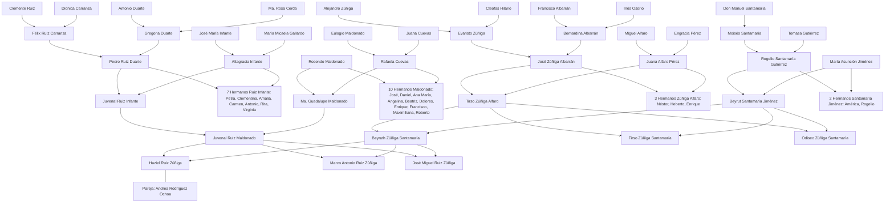

# Árbol Genealógico Familiar en Prolog

**Instituto Tecnológico de Morelia (TecNM)**  
**Departamento de Sistemas y Computación — Ingeniería en Sistemas Computacionales**

| Campo                                   | Detalle                                                                                               |
|:----------------------------------------|:------------------------------------------------------------------------------------------------------|
| **Asignatura**                          | Programación Lógica y Funcional                                                                       |
| **Docente**                             | Prof. Jesús Eduardo Alcaraz Chávez                                                                    |
| **Alumno**                              | Haziel Ruiz Zúñiga                                                                                    |
| **Lenguaje / Motor**                    | Prolog (Estándar ISO / SWI-Prolog)                                                                    |
| **Alcance de la Base de Conocimientos** | 6 generaciones · 4 ramas familiares · 110 personas · 140 hechos `progenitor/2` · 34 hechos `pareja/2` |

## 1. Descripción del Proyecto

Este repositorio implementa una **Base de Conocimientos Genealógica en Prolog** ([`arbol_familiar.pl`](arbol_familiar.pl)) que modela el árbol familiar de la familia **Ruiz Zúñiga** a lo largo de seis generaciones, integrando las cuatro ramas principales de ascendencia paterna y materna:

1. **Rama Paterna-Paterna (Ruiz – Duarte – Infante – Carranza):** Desde los trastatarabuelos Clemente Ruiz y Dionica Carranza, Antonio Duarte y Ma. Rosa Cerda, y José María Infante y María Micaela Gallardo, pasando por Félix Ruiz Carranza, Pedro Ruiz Duarte y Altagracia Infante, hasta el abuelo paterno Juvenal Ruiz Infante y sus hermanos.
2. **Rama Paterna-Materna (Maldonado – Cuevas):** Desde Eulogio Maldonado y Juana Cuevas, pasando por los bisabuelos Rosendo Maldonado y Rafaela Cuevas, hasta la abuela paterna Ma. Guadalupe Maldonado y sus diez hermanos.
3. **Rama Materna-Paterna (Zúñiga – Albarrán – Alfaro – Pérez):** Desde Alejandro Zúñiga y Cleofas Hilario, y Francisco Albarrán e Inés Osorio, pasando por Evaristo Zúñiga y Bernardina Albarrán, y José Zúñiga Albarrán y Juana Alfaro Pérez, hasta el abuelo materno Tirso Zúñiga Alfaro y sus hermanos.
4. **Rama Materna-Materna (Santamaría – Gutiérrez – Jiménez):** Desde Don Manuel Santamaría, pasando por Moisés Santamaría y Tomasa Gutiérrez, y los bisabuelos Rogelio Santamaría Gutiérrez y María Asunción Jiménez, hasta la abuela materna Beyrut Santamaría Jiménez, la madre Beyruth Zúñiga Santamaría y los tíos maternos.

## 2. Diagrama General de Ascendencia Directa y Colateral



## 3. Arquitectura de Hechos y Reglas en Prolog

### 3.1. Convención de Nombres y Predicados Base (Hechos)

Cada persona se representa mediante un átomo en `snake_case`. La base de hechos se apoya en cuatro predicados extensionales:

| Predicado Base     | Aridad | Significado Lógico                                     | Ejemplo en el Código                                         |
|:-------------------|:------:|:-------------------------------------------------------|:-------------------------------------------------------------|
| `hombre(Persona)`  |   1    | Declara que `Persona` es de sexo masculino.            | `hombre(haziel_ruiz_zuniga).`                                |
| `mujer(Persona)`   |   1    | Declara que `Persona` es de sexo femenino.             | `mujer(beyruth_zuniga_santamaria).`                          |
| `progenitor(P, H)` |   2    | Declara que `P` es padre o madre biológico de `H`.     | `progenitor(juvenal_ruiz_maldonado, haziel_ruiz_zuniga).`    |
| `pareja(X, Y)`     |   2    | Declara la unión conyugal o de pareja entre `X` e `Y`. | `pareja(juvenal_ruiz_maldonado, beyruth_zuniga_santamaria).` |

### 3.2. Reglas de Inferencia Implementadas

| Categoría      | Regla en Prolog                         | Definición Formal (Cláusula de Horn)                                              | Descripción                                                           |
|:---------------|:----------------------------------------|:----------------------------------------------------------------------------------|:----------------------------------------------------------------------|
| **Padres**     | `padre(P, H)` / `madre(M, H)`           | `progenitor(P, H), hombre(P) / mujer(M).`                                         | `P` es el padre o `M` es la madre de `H`.                             |
| **Padres**     | `padres(P, M, H)`                       | `padre(P, H), madre(M, H).`                                                       | Obtiene simultáneamente al padre `P` y madre `M` de `H`.              |
| **Hijos**      | `hijo(H, P)` / `hija(H, P)`             | `progenitor(P, H), hombre(H) / mujer(H).`                                         | `H` es hijo varón o hija mujer de `P`.                                |
| **Abuelos**    | `abuelos(A, N)`                         | `progenitor(A, P), progenitor(P, N).`                                             | `A` es abuelo o abuela de `N` (sin distinción de sexo).               |
| **Abuelos**    | `abuelo(A, N)` / `abuela(A, N)`         | `abuelos(A, N), hombre(A) / mujer(A).`                                            | `A` es abuelo o abuela de `N`.                                        |
| **Hermanos**   | `hermanos(X, Y)`                        | `padre(P, X), padre(P, Y), X \= Y.`                                               | `X` e `Y` son hermanos (evita respuestas duplicadas por padre/madre). |
| **Hermanos**   | `hermano(X, Y)` / `hermana(X, Y)`       | `hermanos(X, Y), hombre(X) / mujer(X).`                                           | `X` es hermano varón o hermana mujer de `Y`.                          |
| **Tíos**       | `tio_consanguineo(T, S)`                | `progenitor(P, S), hermanos(T, P).`                                               | `T` es hermano/a de alguno de los padres de `S`.                      |
| **Tíos**       | `tio_politico(T, S)`                    | `progenitor(P, S), hermanos(H, P), casados(T, H).`                                | `T` es cónyuge de un hermano/a de los padres de `S`.                  |
| **Tíos**       | `tios(T, S)`                            | `tio_consanguineo(T, S) ; tio_politico(T, S).`                                    | `T` es tío o tía (consanguíneo o político) de `S`.                    |
| **Tíos**       | `tio(T, S)` / `tia(T, S)`               | `tios(T, S), hombre(T) / mujer(T).`                                               | `T` es tío varón o tía mujer de `S`.                                  |
| **Extendidas** | `tio_abuelo(T, S)` / `tia_abuela(T, S)` | `abuelos(A, S), hermanos(T, A), hombre(T) / mujer(T).`                            | `T` es hermano o hermana de alguno de los abuelos de `S`.             |
| **Extendidas** | `bisabuelos(B, N)`                      | `progenitor(B, A), abuelos(A, N).`                                                | Ascendencia de 3ª generación (reutilizada en `tatarabuelo/2`).        |
| **Recursiva**  | `ancestro(A, D)`                        | Caso base `progenitor(A, D)` + paso recursivo `progenitor(A, X), ancestro(X, D).` | Recorre cualquier número de generaciones hacia arriba.                |

## 4. Resumen de Integrantes por Rama Genealógica

### 4.1. Núcleo Familiar Directo (Generaciones 0, 1 y 2)

| Parentesco con Haziel | Nombre Completo en el Árbol           | Átomo en Prolog             |
|:----------------------|:--------------------------------------|:----------------------------|
| **Persona Central**   | Haziel Ruiz Zúñiga (2003–Vivo)        | `haziel_ruiz_zuniga`        |
| **Pareja**            | Andrea Rodríguez Ochoa (2003–Viva)    | `andrea_rodriguez_ochoa`    |
| **Hermano**           | Marco Antonio Ruiz Zúñiga (2004–Vivo) | `marco_antonio_ruiz_zuniga` |
| **Hermano**           | José Miguel Ruiz Zúñiga (2009–Vivo)   | `jose_miguel_ruiz_zuniga`   |
| **Padre**             | Juvenal Ruiz Maldonado (1968–Vivo)    | `juvenal_ruiz_maldonado`    |
| **Madre**             | Beyruth Zúñiga Santamaría (1976–Viva) | `beyruth_zuniga_santamaria` |
| **Tío Materno**       | Tirso Zúñiga Santamaría (1974–Vivo)   | `tirso_zuniga_santamaria`   |
| **Tío Materno**       | Odiseo Zúñiga Santamaría (1975–Vivo)  | `odiseo_zuniga_santamaria`  |
| **Abuelo Paterno**    | Juvenal Ruiz Infante                  | `juvenal_ruiz_infante`      |
| **Abuela Paterna**    | Ma. Guadalupe Maldonado               | `ma_guadalupe_maldonado`    |
| **Abuelo Materno**    | Tirso Zúñiga Alfaro (1948–2019)       | `tirso_zuniga_alfaro`       |
| **Abuela Materna**    | Beyrut Santamaría Jiménez (Viva)      | `beyrut_santamaria_jimenez` |

### 4.2. Ascendencia Extendida (Generaciones 3, 4 y 5)

| Rama Familiar                           | Bisabuelos (Gen. 3)                                                           | Tatarabuelos (Gen. 4)                                                              | Trastatarabuelos (Gen. 5)                                            |
|:----------------------------------------|:------------------------------------------------------------------------------|:-----------------------------------------------------------------------------------|:---------------------------------------------------------------------|
| **1. Ruiz – Duarte – Infante**          | Pedro Ruiz Duarte y Altagracia Infante                                        | Félix Ruiz Carranza y Gregoria Duarte; José María Infante y María Micaela Gallardo | Clemente Ruiz y Dionica Carranza; Antonio Duarte y Ma. Rosa Cerda    |
| **2. Maldonado – Cuevas**               | Rosendo Maldonado y Rafaela Cuevas                                            | Eulogio Maldonado y Juana Cuevas                                                   | —                                                                    |
| **3. Zúñiga – Albarrán – Alfaro**       | José Zúñiga Albarrán y Juana Alfaro Pérez                                     | Evaristo Zúñiga y Bernardina Albarrán; Miguel Alfaro y Engracia Pérez              | Alejandro Zúñiga y Cleofas Hilario; Francisco Albarrán e Inés Osorio |
| **4. Santamaría – Gutiérrez – Jiménez** | Rogelio Santamaría Gutiérrez (1934–1998) y María Asunción Jiménez (1936–1983) | Moisés Santamaría (1884–1965) y Tomasa Gutiérrez (1915–1999)                       | Don Manuel Santamaría (Padre de 10 hijos nacidos entre 1871 y 1894+) |

## 5. Guía de Uso y Consultas de Prueba en SWI-Prolog

### 5.1. Cómo cargar la Base de Conocimientos ([`arbol_familiar.pl`](arbol_familiar.pl))

```bash
swipl -s arbol_familiar.pl
```

O dentro de la consola interactiva de Prolog:

```prolog
?- [arbol_familiar].
true.
```

### 5.2. Batería de Consultas (`Queries`) y Resultados Esperados

| Objetivo de la Consulta                                                             | Comando en SWI-Prolog (`?-`)                          | Resultado Esperado del Motor Lógico                                                                                                                                                                                                                                                                                      |
|:------------------------------------------------------------------------------------|:------------------------------------------------------|:-------------------------------------------------------------------------------------------------------------------------------------------------------------------------------------------------------------------------------------------------------------------------------------------------------------------------|
| **1. Consultar el padre de Haziel**                                                 | `?- padre(Padre, haziel_ruiz_zuniga).`                | `Padre = juvenal_ruiz_maldonado.`                                                                                                                                                                                                                                                                                        |
| **2. Consultar la madre de Haziel**                                                 | `?- madre(Madre, haziel_ruiz_zuniga).`                | `Madre = beyruth_zuniga_santamaria.`                                                                                                                                                                                                                                                                                     |
| **3. Consultar ambos padres a la vez**                                              | `?- padres(Padre, Madre, haziel_ruiz_zuniga).`        | `Padre = juvenal_ruiz_maldonado, Madre = beyruth_zuniga_santamaria.`                                                                                                                                                                                                                                                     |
| **4. Listar los hermanos de Haziel**                                                | `?- hermano(Hermano, haziel_ruiz_zuniga).`            | `Hermano = marco_antonio_ruiz_zuniga ; Hermano = jose_miguel_ruiz_zuniga.`                                                                                                                                                                                                                                               |
| **5. Consultar los abuelos varones de Haziel**                                      | `?- abuelo(Abuelo, haziel_ruiz_zuniga).`              | `Abuelo = juvenal_ruiz_infante ; Abuelo = tirso_zuniga_alfaro.`                                                                                                                                                                                                                                                          |
| **6. Consultar las abuelas de Haziel**                                              | `?- abuela(Abuela, haziel_ruiz_zuniga).`              | `Abuela = ma_guadalupe_maldonado ; Abuela = beyrut_santamaria_jimenez.`                                                                                                                                                                                                                                                  |
| **7. Listar los 4 abuelos de Haziel**                                               | `?- abuelos(Abuelo, haziel_ruiz_zuniga).`             | `juvenal_ruiz_infante`, `ma_guadalupe_maldonado`, `tirso_zuniga_alfaro`, `beyrut_santamaria_jimenez`                                                                                                                                                                                                                     |
| **8. Consultar los tíos directos de Haziel**                                        | `?- tio(Tio, haziel_ruiz_zuniga).`                    | `Tio = tirso_zuniga_santamaria ; Tio = odiseo_zuniga_santamaria.`                                                                                                                                                                                                                                                        |
| **9. Consultar los tíos de Juvenal Ruiz Maldonado (Rama Ruiz y Maldonado)**         | `?- tios(Tio, juvenal_ruiz_maldonado).`               | Retorna los 7 hermanos de Juvenal Ruiz Infante (+4 parejas políticas) y los 10 hermanos de Ma. Guadalupe Maldonado.                                                                                                                                                                                                      |
| **10. Consultar los tíos de Beyruth Zúñiga Santamaría (Rama Zúñiga y Santamaría)**  | `?- tios(Tio, beyruth_zuniga_santamaria).`            | Retorna a `nestor_zuniga_alfaro`, `heberto_zuniga_alfaro`, `enrique_zuniga_alfaro`, `america_santamaria_jimenez`, `rogelio_santamaria_jimenez` y `jaime_iglesias`.                                                                                                                                                       |
| **11. Consultar los tíos abuelos de Haziel**                                        | `?- tio_abuelo(TioAbuelo, haziel_ruiz_zuniga).`       | Retorna los 11 tíos abuelos varones de las 4 ramas (`antonio_ruiz_infante`, `jose_maldonado`, `daniel_maldonado`, `enrique_maldonado`, `francisco_maldonado`, `roberto_maldonado`, `nestor_zuniga_alfaro`, `heberto_zuniga_alfaro`, `enrique_zuniga_alfaro`, `rogelio_santamaria_jimenez`).                              |
| **12. Consultar las tías abuelas de Haziel**                                        | `?- tia_abuela(TiaAbuela, haziel_ruiz_zuniga).`       | Retorna las 12 tías abuelas (`petra_ruiz_infante`, `clementina_ruiz_infante`, `amalia_ruiz_infante`, `carmen_ruiz_infante`, `rita_ruiz_infante`, `virginia_ruiz_infante`, `ana_maria_maldonado`, `angelina_maldonado`, `beatriz_maldonado`, `dolores_maldonado`, `maximiliana_maldonado`, `america_santamaria_jimenez`). |
| **13. Consultar los bisabuelos de Haziel**                                          | `?- bisabuelo(Bisabuelo, haziel_ruiz_zuniga).`        | `pedro_ruiz_duarte`, `rosendo_maldonado`, `jose_zuniga_albarran`, `rogelio_santamaria_gutierrez`.                                                                                                                                                                                                                        |
| **14. Verificar si Don Manuel Santamaría es ancestro de Haziel**                    | `?- ancestro(manuel_santamaria, haziel_ruiz_zuniga).` | `true.`                                                                                                                                                                                                                                                                                                                  |
| **15. Verificar relación de primos entre generaciones**                             | `?- primos(juvenal_ruiz_maldonado, X).`               | Evalúa primos carnales según hijos registrados de los tíos.                                                                                                                                                                                                                                                              |
